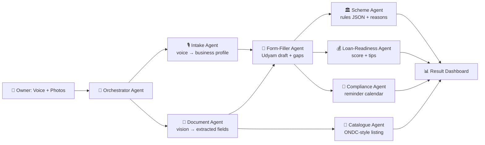

# 🧾 Udyam Saathi

> **An AI agent that makes MP's small businesses paperwork-ready, loan-ready and ONDC-ready. Owners just talk and take photos.**

Built for **Hackathon – 11th TiE Global Summit 2026**
Track: **The Rise of New India (Indore & MP · Bharat · Regional Growth)**, with **Applied AI & Agentic Intelligence** as the secondary track

---

## 📌 Table of Contents
1. [Problem](#-problem)
2. [Solution](#-solution)
3. [Demo Story (3-minute flow)](#-demo-story-3-minute-flow)
4. [Core Features](#-core-features)
5. [Multi-Agent Architecture](#-multi-agent-architecture)
6. [Tech Stack](#-tech-stack)
7. [Project Structure](#-project-structure)
8. [Data Models](#-data-models)
9. [API Endpoints](#-api-endpoints)
10. [Agent Prompts & Tool Design](#-agent-prompts--tool-design)
11. [Screens / UI](#-screens--ui)
12. [Getting Started](#-getting-started)
13. [Environment Variables](#-environment-variables)
14. [Deploy to Vercel](#-deploy-to-vercel)
15. [Sample Data for the Demo](#-sample-data-for-the-demo)
16. [Privacy & Security](#-privacy--security)
17. [Business Model](#-business-model)
18. [Roadmap](#-roadmap)
19. [Hackathon Build Plan](#-hackathon-build-plan)
20. [Judging Alignment](#-judging-alignment)
21. [Team](#-team)

---

## ❗ Problem

Micro and small business owners in Indore and Madhya Pradesh often:
- Struggle with **English-only, complex forms** (Udyam registration, GST, loan applications)
- Don't know which **central/state schemes** they are eligible for
- Can't get **formal credit** because they have no documented financial history
- Aren't selling online because **creating a digital catalogue** feels hard
- Depend on **paid agents/middlemen** for basic paperwork

> ⚠️ Add verified MP MSME statistics (source + year) to the pitch deck before the event. Do not use unverified numbers.

---

## ✅ Solution

**Udyam Saathi** is a voice-first, Hindi-first AI agent. The owner:
1. 🎙️ **Talks** – describes their business in Hindi/English (voice note)
2. 📸 **Takes photos** – Aadhaar, PAN, shop board, bill book, products

The agents then **do the work**:

| Outcome | What the user gets |
|---|---|
| 📄 **Paperwork-ready** | Pre-filled Udyam registration draft + document gap check |
| 💰 **Loan-ready** | Loan-readiness score + simple credit profile from bill-book photos |
| 🛒 **ONDC-ready** | Auto-generated product catalogue (name, description, price, category) |
| 🏛️ **Scheme-matched** | Eligible schemes with **reasons** ("why you qualify") |
| 📅 **Compliance-ready** | GST/renewal reminder calendar |

The owner **always reviews and confirms** before anything is submitted. The app produces drafts and never submits to government portals automatically.

---

## 🎬 Demo Story (3-minute flow)

**Persona:** *Sunita (fictional)*, makes papad at home in Indore.

1. Sunita records a 30-second Hindi voice note: *"Main ghar se papad banati hoon, mahine ka 40–50 hazaar ka kaam hai…"*
2. She uploads 3 photos: Aadhaar (masked), bill book page, product photo.
3. The **Agent Timeline** shows each agent working, with visible reasoning.
4. Output dashboard:
   - ✅ Udyam form draft (90% filled, 1 field needs confirmation)
   - ⚠️ Missing: bank account proof
   - 🏛️ 2 matched schemes with eligibility reasons
   - 💰 Loan-readiness score: 62/100 + "3 steps to improve"
   - 🛒 ONDC catalogue: 3 products ready
5. Sunita can download a PDF summary and share it on WhatsApp.

---

## ✨ Core Features

### MVP (build at the hackathon)
- [ ] Hindi/English voice input (Web Speech API, with text fallback)
- [ ] Photo/document upload (camera on mobile)
- [ ] Document reading via LLM vision (Aadhaar/PAN/bill book/product)
- [ ] Aadhaar masking (show only last 4 digits)
- [ ] Udyam registration **draft** form auto-fill
- [ ] Missing-document checker
- [ ] Scheme matcher (rules from JSON, explained by LLM)
- [ ] Loan-readiness score (rule-based + LLM explanation)
- [ ] ONDC-style catalogue generator
- [ ] Compliance calendar (GST/renewal reminders)
- [ ] **Agent Timeline** – live, visible reasoning steps
- [ ] Hindi/English UI toggle
- [ ] Download summary as PDF

### Nice to have
- [ ] WhatsApp share / WhatsApp bot entry point
- [ ] Hindi text-to-speech reply
- [ ] District dashboard for MPSEDC/MSME department (anonymized)
- [ ] Lender referral handoff screen

---

## 🧠 Multi-Agent Architecture



| Agent | Input | Output | Approach |
|---|---|---|---|
| **Orchestrator** | Session state | Calls agents in order, streams progress | Deterministic pipeline (not free-form) for demo reliability |
| **Intake Agent** | Voice transcript | `BusinessProfile` JSON | LLM + JSON schema |
| **Document Agent** | Images | `ExtractedDocument[]` | LLM vision + JSON schema |
| **Form-Filler Agent** | Profile + documents | `UdyamDraft`, `missingFields[]` | LLM + field mapping rules |
| **Scheme Agent** | Profile | `SchemeMatch[]` with reasons | **Rules engine first**, LLM only explains |
| **Loan-Readiness Agent** | Profile + bill data | Score 0–100 + tips | Rule-based scoring, LLM explains |
| **Catalogue Agent** | Product photos + profile | `CatalogueItem[]` | LLM vision |
| **Compliance Agent** | Profile | `Reminder[]` | Rules (static calendar) |

**Design principle:** *LLM for understanding and explaining, rules for decisions.* This prevents made-up schemes or scores and answers the "ChatGPT wrapper" question.

---

## 🛠️ Tech Stack

| Layer | Choice |
|---|---|
| Frontend | React 18 + TypeScript + Vite |
| Styling | Tailwind CSS + shadcn/ui |
| State | Zustand |
| Routing | React Router |
| i18n | i18next (Hindi + English) |
| Voice | Web Speech API (`hi-IN`, `en-IN`) |
| Backend | Vercel Serverless Functions (`/api/*`, TypeScript) |
| AI | Azure OpenAI **or** Google Gemini (vision + JSON output) |
| Validation | Zod (shared schemas for frontend + API) |
| PDF | jsPDF or @react-pdf/renderer |
| Charts | Recharts (loan score gauge, district dashboard) |
| Hosting | Vercel |
| Storage (MVP) | Browser only (IndexedDB / localStorage), no server DB |

---

## 📁 Project Structure

```
udyam-saathi/
├── api/                          # Vercel serverless functions
│   ├── intake.ts                 # voice transcript → BusinessProfile
│   ├── extract-document.ts       # image → ExtractedDocument
│   ├── fill-form.ts              # → UdyamDraft + missing fields
│   ├── match-schemes.ts          # rules + LLM explanation
│   ├── loan-readiness.ts         # score + tips
│   ├── catalogue.ts              # product images → catalogue
│   └── _lib/
│       ├── llm.ts                # provider wrapper (Azure OpenAI / Gemini)
│       ├── prompts.ts            # system prompts per agent
│       ├── mask.ts               # Aadhaar/PAN masking
│       └── rateLimit.ts
├── src/
│   ├── main.tsx
│   ├── App.tsx
│   ├── pages/
│   │   ├── Home.tsx              # language select + "Start"
│   │   ├── Capture.tsx           # voice + photo capture
│   │   ├── Processing.tsx        # Agent Timeline
│   │   ├── Results.tsx           # dashboard (tabs)
│   │   └── DistrictDashboard.tsx # optional, govt view
│   ├── components/
│   │   ├── VoiceRecorder.tsx
│   │   ├── PhotoUploader.tsx
│   │   ├── AgentTimeline.tsx
│   │   ├── UdyamDraftCard.tsx
│   │   ├── SchemeCard.tsx
│   │   ├── LoanScoreGauge.tsx
│   │   ├── CatalogueGrid.tsx
│   │   ├── ComplianceCalendar.tsx
│   │   └── LanguageToggle.tsx
│   ├── agents/
│   │   └── orchestrator.ts       # client-side pipeline runner
│   ├── data/
│   │   ├── schemes.sample.json   # SAMPLE rules – verify before use
│   │   ├── compliance.json
│   │   └── demo/                 # demo images + transcript
│   ├── lib/
│   │   ├── schemas.ts            # Zod schemas (shared)
│   │   ├── scoring.ts            # loan-readiness rules
│   │   ├── schemeRules.ts        # eligibility engine
│   │   └── pdf.ts
│   ├── store/useSession.ts
│   └── i18n/{en.json,hi.json}
├── public/
├── .env.example
├── vercel.json
├── package.json
└── README.md
```

---

## 🧩 Data Models

```ts
// src/lib/schemas.ts (Zod → TS types)
export type BusinessProfile = {
  ownerName?: string;
  gender?: "female" | "male" | "other";
  businessName?: string;
  activity: string;                 // e.g. "papad manufacturing"
  category: "manufacturing" | "services" | "trading";
  district: string;                 // e.g. "Indore"
  location: "urban" | "rural";
  monthlyTurnoverINR?: number;
  employees?: number;
  yearsInBusiness?: number;
  hasGST: boolean;
  hasUdyam: boolean;
  hasBankAccount: boolean;
  socialCategory?: "general" | "sc" | "st" | "obc" | "minority";
  language: "hi" | "en";
};

export type ExtractedDocument = {
  type: "aadhaar" | "pan" | "bill_book" | "product" | "shop_board" | "bank_passbook" | "unknown";
  fields: Record<string, string>;   // Aadhaar always masked: XXXX-XXXX-1234
  confidence: number;               // 0–1
  warnings: string[];
};

export type UdyamDraft = {
  fields: { label: string; value: string; source: string; confirmed: boolean }[];
  missingFields: string[];
  completionPercent: number;
};

export type SchemeMatch = {
  id: string;
  name: string;
  matched: boolean;
  reasons: string[];                // "Because you are a woman entrepreneur in manufacturing…"
  nextSteps: string[];
  documentsNeeded: string[];
};

export type LoanReadiness = {
  score: number;                    // 0–100
  band: "low" | "medium" | "high";
  factors: { name: string; impact: number; note: string }[];
  improvementTips: string[];
};

export type CatalogueItem = {
  name: string; nameHi: string;
  description: string;
  category: string;
  suggestedPriceINR?: number;
  unit: string;
  imageUrl: string;
};

export type AgentStep = {
  agent: string;
  status: "pending" | "running" | "done" | "error";
  reasoning: string[];              // shown in Agent Timeline
  durationMs?: number;
};
```

---

## 🔌 API Endpoints

| Method | Route | Body | Returns |
|---|---|---|---|
| POST | `/api/intake` | `{ transcript, language }` | `BusinessProfile` |
| POST | `/api/extract-document` | `{ imageBase64, hintType? }` | `ExtractedDocument` |
| POST | `/api/fill-form` | `{ profile, documents }` | `UdyamDraft` |
| POST | `/api/match-schemes` | `{ profile }` | `SchemeMatch[]` |
| POST | `/api/loan-readiness` | `{ profile, documents }` | `LoanReadiness` |
| POST | `/api/catalogue` | `{ images[], profile }` | `CatalogueItem[]` |

All responses are validated with Zod. On validation failure, retry once, then return a safe fallback.

---

## 🤖 Agent Prompts & Tool Design

**Global system rules (all agents):**
```
You are part of Udyam Saathi, an assistant for micro-businesses in Madhya Pradesh.
- Respond ONLY in valid JSON matching the provided schema.
- Never invent document values. If unreadable, return null and add a warning.
- Always mask Aadhaar numbers to the last 4 digits.
- Use simple Hindi when language = "hi".
- Never give legal or financial guarantees.
```

**Intake Agent:**
```
Extract a BusinessProfile from this owner's spoken description (may be Hindi, Hinglish or English).
Infer category (manufacturing/services/trading). Convert spoken amounts ("40-50 hazaar") to numbers.
Return unknown fields as null.
```

**Scheme Agent (explain-only):**
```
You receive a BusinessProfile and a list of schemes ALREADY evaluated by the rules engine.
For each matched scheme, write 1–3 short reasons and next steps in the user's language.
Do NOT add schemes that are not in the list.
```

**Loan-Readiness Agent (explain-only):**
```
You receive a computed score and factor breakdown. Explain it in 2 lines and give 3 practical tips.
Do NOT change the score.
```

---

## 🖥️ Screens / UI

1. **Home** – big "बोलिए और शुरू कीजिए / Speak to start" button, language toggle
2. **Capture** – mic button with live transcript; photo tiles (Aadhaar, PAN, Bill book, Product)
3. **Processing** – **Agent Timeline** (the key "wow" screen): each agent card expands to show reasoning
4. **Results** – tabs: `Paperwork` · `Schemes` · `Loan` · `ONDC Catalogue` · `Reminders`
5. **Summary** – download PDF / share on WhatsApp
6. **District Dashboard** (optional) – anonymized counts by district, top gaps, schemes demand

**UX rules:** mobile-first, large tap targets, icons + Hindi labels, works on low bandwidth (compress images to ≤1 MB before upload).

---

## 🚀 Getting Started

```bash
# 1. Create project
npm create vite@latest udyam-saathi -- --template react-ts
cd udyam-saathi

# 2. Install dependencies
npm i react-router-dom zustand zod i18next react-i18next recharts jspdf
npm i -D tailwindcss postcss autoprefixer @vercel/node vercel
npx tailwindcss init -p

# 3. Environment
cp .env.example .env.local

# 4. Run locally (frontend + /api functions)
npx vercel dev
```

---

## 🔐 Environment Variables

```env
# Choose one provider
LLM_PROVIDER=azure            # azure | gemini

# Azure OpenAI
AZURE_OPENAI_ENDPOINT=
AZURE_OPENAI_API_KEY=
AZURE_OPENAI_DEPLOYMENT=       # vision-capable model deployment

# Gemini
GEMINI_API_KEY=
GEMINI_MODEL=

# App
DEMO_MODE=true                 # uses cached responses if LLM fails
```

> Never expose API keys in the frontend. All LLM calls go through `/api/*`.

---

## ☁️ Deploy to Vercel

1. Push the repo to GitHub
2. On Vercel: **Add New → Project → Import** the repo
3. Framework preset: **Vite**
4. Add environment variables (Production + Preview)
5. Deploy

`vercel.json`:
```json
{
  "functions": { "api/**/*.ts": { "maxDuration": 30 } },
  "rewrites": [{ "source": "/((?!api/).*)", "destination": "/index.html" }]
}
```

---

## 🧪 Sample Data for the Demo

Keep under `src/data/demo/`:
- `sunita_transcript_hi.txt` – sample Hindi voice transcript
- `aadhaar_sample_masked.png` – **dummy** card (never real data)
- `billbook_page.jpg` – handwritten sample bill page
- `product_papad.jpg` – product photo
- `cached_responses.json` – fallback outputs for `DEMO_MODE`

`schemes.sample.json` (structure only, **verify scheme names and criteria from official MSME/MP government sources before the event**):
```json
[
  {
    "id": "scheme-001",
    "name": "<Verified scheme name>",
    "level": "central",
    "rules": {
      "category": ["manufacturing", "services"],
      "maxTurnoverINR": 5000000,
      "requiresUdyam": false,
      "womenPriority": true
    },
    "documentsNeeded": ["Aadhaar", "PAN", "Bank passbook"],
    "officialLink": "<official URL>"
  }
]
```

---

## 🛡️ Privacy & Security

- Explicit **consent screen** before any upload
- Aadhaar masked **before** display and storage; full number never stored
- No server-side database in MVP; data stays in the browser session
- Images sent only to the LLM API for extraction, not persisted
- "Delete my data" button clears local storage
- Designed with India's **DPDP Act** principles in mind (consent, purpose limitation, minimisation)
- Output is a **draft for review**, never auto-submitted

---

## 💼 Business Model

| Stream | Who pays |
|---|---|
| Free core app | – (vendor adoption) |
| Lender referral fee | Banks / NBFCs / fintech partners |
| GST filing assist plan (~₹99/month) | MSME owner |
| District insight dashboards | Government / MSME department |
| White-label for other states | State IT agencies |

---

## 🗺️ Roadmap

| Phase | Scope |
|---|---|
| **Hackathon MVP** | Web app, Hindi/English, 6 agents, demo data |
| **Pilot (Indore)** | Onboard real MSMEs with a partner, WhatsApp entry, Malwi voice |
| **MP scale** | All districts, district dashboards, lender integrations |
| **Bharat scale** | More languages, state-specific scheme packs, ONDC seller-app integration |

---

## ⏱️ Hackathon Build Plan

| Hours | Task |
|---|---|
| 0–2 | Vite + Tailwind + routing + i18n skeleton, deploy empty app to Vercel |
| 2–5 | Voice recorder + photo uploader + Zustand session |
| 5–9 | `/api` LLM wrapper + Intake + Document agents |
| 9–12 | Form-filler + rules engine (schemes, loan score) |
| 12–15 | Catalogue agent + Compliance calendar |
| 15–18 | Agent Timeline UI + Results tabs |
| 18–20 | PDF export, Hindi polish, DEMO_MODE fallback |
| 20–22 | Rehearse demo, record backup video |
| 22–24 | Pitch deck + buffer |

---

## 🏆 Judging Alignment

| Sponsor / judge group | What Udyam Saathi shows |
|---|---|
| MPSEDC / MSME department | Formalisation of MP micro-businesses + district insights |
| Venture Catalysts / investors | Clear revenue streams, scalable to every state |
| Finance partners | Bill book → credit profile → loan readiness |
| FICCI FLO | Designed for women home-based entrepreneurs |
| WaVo AI | Voice-first Hindi AI agent |
| Hack2Skill criteria | Innovation, working demo, impact, feasibility |

---

## 👥 Team

| Name | Role |
|---|---|
| Kiran K N | Product + Full-stack (React/TS, AI agents) |
| _Add members_ | |

---

## 📄 License
MIT (hackathon prototype). Scheme data is illustrative and must be verified from official sources.
